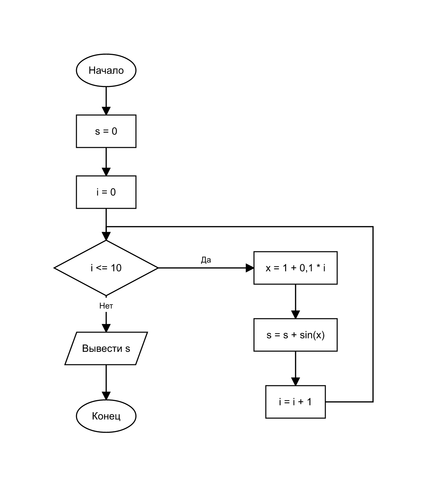

# Домашнее задание к работе 8

## Условие задачи
Вычислить с использованием цикла `for` значение суммы sin 1 + sin 1,1 + sin 1,2 + … + sin 2, то есть сумму синусов чисел от 1 до 2 с шагом 0,1. (Вариант 14)

## 1. Алгоритм и блок-схема

### Алгоритм
1. **Начало**
2. Присвоить начальные значения: **s = 0**, **i = 0**.
3. Проверить условие **i ≤ 10**:
   - ветвь «Да»: вычислить **x = 1 + 0,1 · i** (x принимает значения 1; 1,1; 1,2; …; 2), прибавить к сумме синус аргумента **s = s + sin(x)**, увеличить счётчик **i = i + 1** и вернуться к проверке условия;
   - ветвь «Нет»: перейти к выводу результата.
4. Вывести значение суммы **s**.
5. **Конец**

Значение x вычисляется по целочисленному счётчику **i**, а не накоплением шага 0,1. При накоплении значение x в конце получается примерно 2,0000000000000009, условие x ≤ 2 не выполняется, и слагаемое sin 2 потерялось бы. Целочисленный счётчик i решает эту проблему.

### Блок-схема


## 2. Реализация программы

```c
#define _CRT_SECURE_NO_DEPRECATE

#include <stdio.h>
#include <stdlib.h>
#include <math.h>

int main() {
    double s = 0;
    double x;

    system("chcp 65001 > nul");

    for (int i = 0; i <= 10; i++) {
        x = 1 + 0.1 * i;
        s += sin(x);
    }

    printf("Значение суммы: %.4f\n", s);

    system("pause");
    return 0;
}
```

## 3. Результаты работы программы

В этом варианте данные с клавиатуры не вводятся, все значения заданы в условии. Программа сразу выводит результат:

```
Значение суммы: 10.4319
```

## 4. Информация о разработчике
Сбоев Даниил, бОТИ-261
